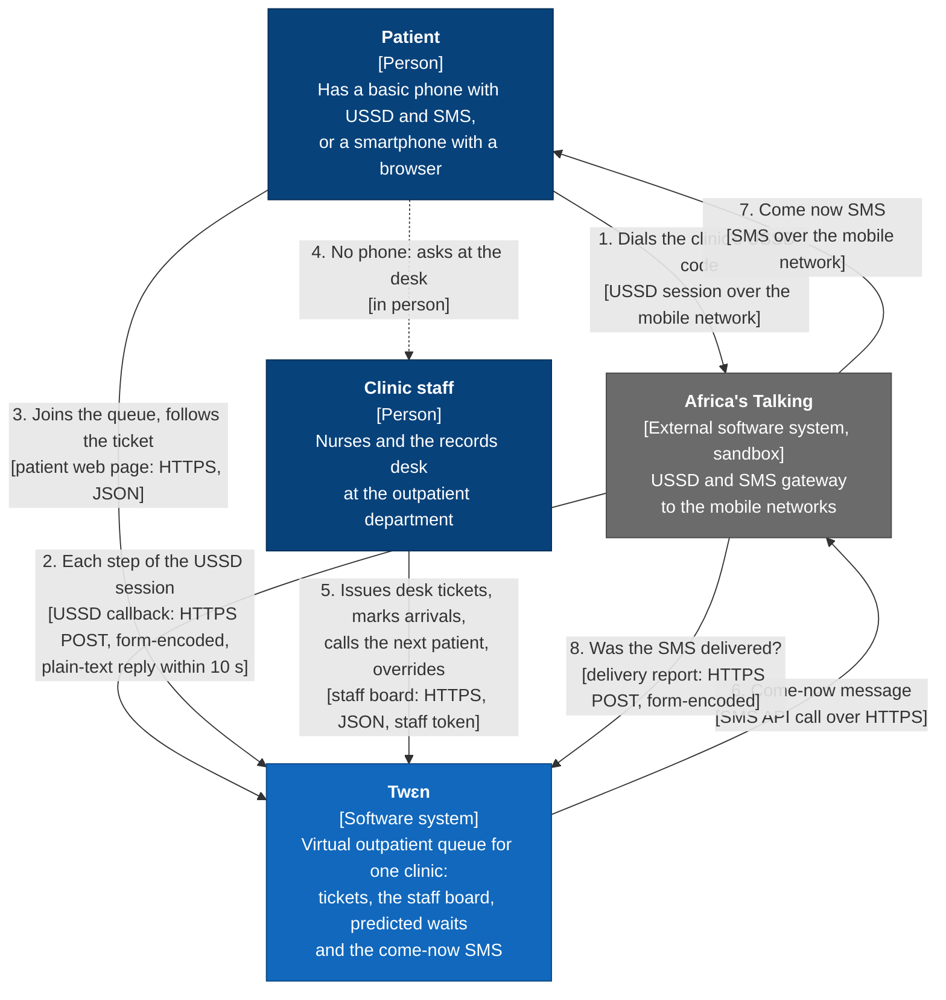
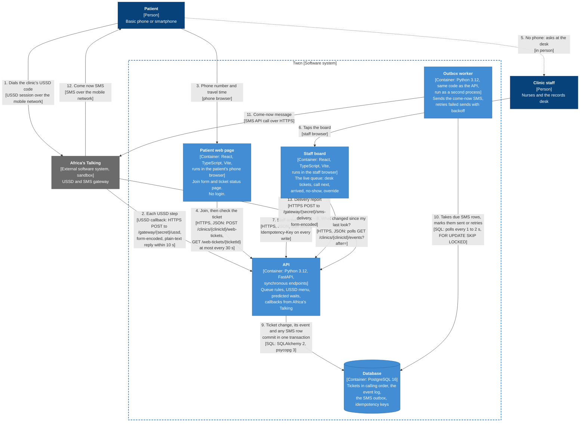

# C4 diagrams: system context and containers

**Status:** draft for [#48](https://github.com/ASU-MICS-2028/se-company-a-capstone/issues/48), part of [#7](https://github.com/ASU-MICS-2028/se-company-a-capstone/issues/7). Levels 1 and 2 only. They follow four proposals that are still under review: API contract v0.2 ([PR #55](https://github.com/ASU-MICS-2028/se-company-a-capstone/pull/55)), the architecture style, stack and hosting decisions ([PR #57](https://github.com/ASU-MICS-2028/se-company-a-capstone/pull/57)), the data model ([PR #62](https://github.com/ASU-MICS-2028/se-company-a-capstone/pull/62)) and the predictor interface ([PR #56](https://github.com/ASU-MICS-2028/se-company-a-capstone/pull/56)). If a review changes one of them, these diagrams change with it.

## What C4 is

C4 draws one software system at four zoom levels, like a map that zooms in ([several views of one system](../../knowledge/multiple-diagram-perspectives.md)):

1. **Context:** the system is one box, with the people and outside systems around it.
2. **Containers:** open the box and show each part that runs on its own. In C4, a *container* is any separately running thing that holds code or data: a server app, a database, a web app running in a browser. It does not mean a Docker container.
3. **Components:** open one container and show its main parts. Not drawn yet.
4. **Code:** classes and functions. We won't draw it; the code is the code.

**How to read the diagrams.** Dark blue is a person, blue is ours, grey is outside our control, and a cylinder is a database. Each arrow says what flows, then, in square brackets, how it travels. Arrows are numbered so the key and the Q&A can name them ([lecture habit](../../knowledge/box-and-line-diagrams.md)), in the order of a patient's day: join the queue, then get the "come now" SMS. A dotted arrow happens in person, with no software.

## Level 1: system context

**Figure C4-1:** Twɛn, the two kinds of people who use it, and the one outside system it depends on.



### Key for Figure C4-1

| Element | What it is | Why it is its own box |
|---|---|---|
| **Patient** | Anyone joining the outpatient queue. There are three ways in: USSD on any phone (arrows 1 and 2), the web page on a smartphone (3), or the desk for someone with no phone (4 and 5). | The person the system exists for: they wait somewhere other than the clinic bench and come when the SMS says so (7). |
| **Clinic staff** | Nurses and the records desk. They use the staff board. | Different people with different rights. Only staff issue desk tickets, call patients, mark no-shows and override the order, and the system records which staff user did it. |
| **Twɛn** | Everything we build, drawn as one box. Level 2 opens it. | The context view is about the edge: what is ours, and what we depend on but don't control. |
| **Africa's Talking** | The gateway that turns a phone's USSD steps into web requests to us (2), and our web requests into SMS (6 and 7). We use its sandbox: no real handsets, as the scope cut says. | We don't run it, and it can be slow or down. So Twɛn never waits on it while answering a patient or a nurse. Level 2 shows how. |

- **Arrows 2 and 8 are callbacks:** Africa's Talking calls us, so even development needs a public address (an ngrok tunnel, in [PR #57](https://github.com/ASU-MICS-2028/se-company-a-capstone/pull/57)). Its docs ask for a "valid and accessible URL" and don't say it must be HTTPS. HTTPS is our choice in both development and the demo.
- **The 10 seconds** comes from the Africa's Talking USSD docs: "the expected response time from your application is at most 10 seconds." A slower reply fails the patient's session.
- **Left out on purpose:** the mobile network operators (Africa's Talking connects to them, so they sit inside its box), WhatsApp, other clinics and any records or insurance system. All of these are Won'ts in the [scope cut](../../decisions/2026-11-23-cut-scope-to-fit-milestone-2.md). Henry's model training is also absent, because it runs offline and is not part of the running system.

## Level 2: containers

**Figure C4-2:** The five parts of Twɛn that run separately, and what passes between them and Africa's Talking.



### Key for Figure C4-2

| Element | What it does | Why it is separate |
|---|---|---|
| **Patient web page** | Kobina's (#10). The patient enters a phone number and a travel band and gets a ticket code, then a status page that refreshes at most every 30 s (arrows 3 and 4). It needs no login. Its two endpoints are rate-limited, and the status page shows one ticket's public fields only. | It runs in the patient's browser, not on our server, and it has different users and rights from the staff board: no staff token, and no view of other patients. |
| **Staff board** | Kobina's (#10). The live queue: issue desk tickets, mark arrived, call next, no-show and override (7). It learns what changed by polling the event log (8) instead of keeping a live connection open. | It runs in the clinic's browser. Polling is simple, and the same event log, together with the repeat-safe writes, can later become the sync channel for the offline board (a Should). |
| **API** | The only place the queue rules live. It answers both web apps, runs the USSD menu (2) and records delivery reports (13). It predicts waits in-process, with no network call (PR #56: under 50 ms for 95 calls in 100). | It is the one server app of the modular monolith: all modules share one code base, one database and one transaction. Synchronous endpoints are enough for one clinic (PR #57). |
| **Outbox worker** | Takes each due SMS row, sends it through Africa's Talking (11), marks it sent and retries failures with backoff (10). PR #57 also gives it the choice of *when* to send, from the predicted wait and the patient's travel band. How it does that is #52's job. | It is a second process from the same code (`python -m app.worker` in PR #57). A slow or hung SMS call, or a crash, can't freeze the board or the USSD replies. |
| **Database** | PostgreSQL 16, with the tables in PR #62: tickets in calling order, the append-only event log, the SMS outbox, the idempotency keys, the clinic settings and staff users. | It holds everything that must survive a restart. Its row locks are what stop two nurses calling the same patient and two workers sending the same SMS. |
| **Africa's Talking** | As in Figure C4-1. | Outside our control. Only the worker calls it, and never inside a patient's or a nurse's request. |

- **There is no arrow between the API and the worker.** They never call each other. The API writes the SMS row in the same transaction as the ticket change (9), and the worker finds it later (10). If the worker is down, the rows wait in the table and go out when it restarts, so no message is lost. This is the [transactional outbox](../../knowledge/transactional-outbox.md). Delivery is at least once. A message can be sent twice only if the worker crashes after Africa's Talking accepts it but before our commit (PR #57).
- **Repeat-safe writes.** Clinic networks drop replies, so the board sends an `Idempotency-Key` with every write (7). A retry with the same key gets the first answer back instead of doing the action twice.
- **Data structures on the arrows** ([lecture habit](../../knowledge/data-structures-in-high-level-diagrams.md)): the queue is first come, first served among patients who have arrived, and a logged staff override moves someone ahead. The event log only grows, so the board asks for everything after the last number it saw (8). The outbox is a work queue, taken in order of each row's next try (10).
- **Styles this view shows** (PR #57): a *modular monolith* (the API and the worker are one code base on one database), *event-driven notification through an outbox* (arrows 9 to 11) and *client-server polling an event log* (8). The fourth style, the *hexagonal core*, sits inside the API, so it shows at level 3.

**What has no box, and why:**

- **The predictor** (naive, M/M/c, and later Henry's model file) is code inside the API, not a separate running thing. It appears at level 3.
- **The reverse proxy, the virtual machine, Docker Compose and the ngrok tunnel** say *where* things run, not *what* runs. They go in the deployment view, as does where the built board and page files are served from.
- **The board and the page as one build or two** is Kobina's call (#10). They are drawn apart because different people use them with different rights.
- **Staff login.** The demo uses seeded staff tokens. Issuing tokens is out of scope in contract v0.2.

## Not drawn yet

Both come later in #48:

- **Level 3, components of the API:** the hexagonal core and its adapters for SMS, USSD and the predictor. Following PR #57, the database is a plain data module there, not a port.
- **The deployment view:** where each container runs in development (a laptop, with Africa's Talking callbacks through ngrok) and for the demo (an Oracle Cloud Always Free VM running Docker Compose, with Azure for Students as the fallback), and what happens when the network or the SMS provider is down.

## Editing these diagrams

The diagrams are Mermaid source, and GitHub draws them when it shows this file. For a quick look, paste one block into the [Mermaid Live Editor](https://mermaid.live). To check both locally with the Mermaid CLI, run this from the repo root:

```bash
PUPPETEER_EXECUTABLE_PATH="/Applications/Google Chrome.app/Contents/MacOS/Google Chrome" pnpm dlx @mermaid-js/mermaid-cli -i docs/architecture/c4.md -o /tmp/c4.svg
```

It writes one SVG per diagram (`/tmp/c4-1.svg`, `/tmp/c4-2.svg`) and stops with an error if the source doesn't parse. pnpm skips the CLI's own browser download, so the variable points it at an installed Chrome. That path is for macOS; on Linux or WSL, use the path that `which google-chrome` prints.
