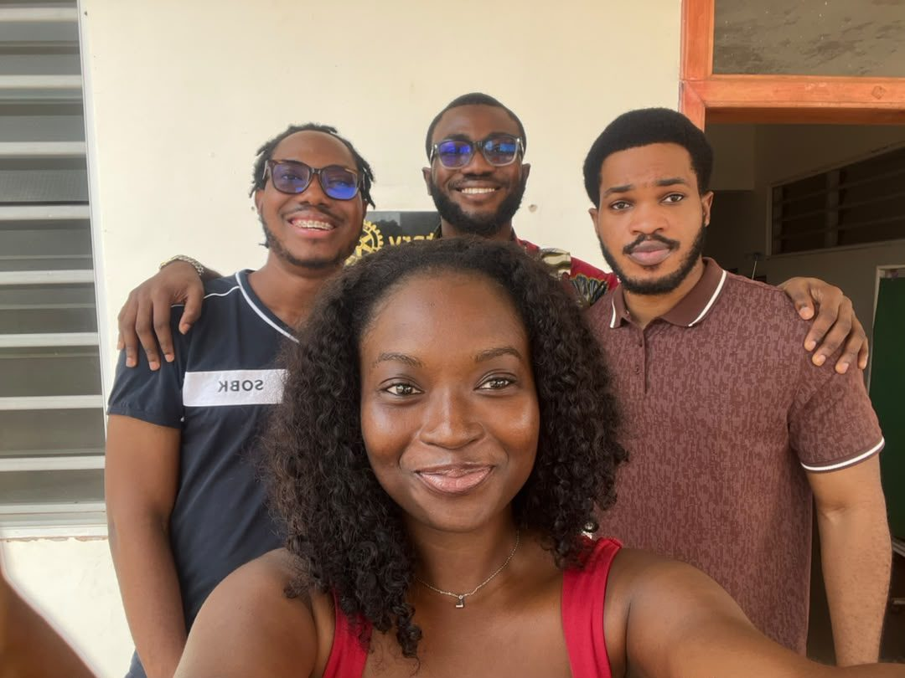
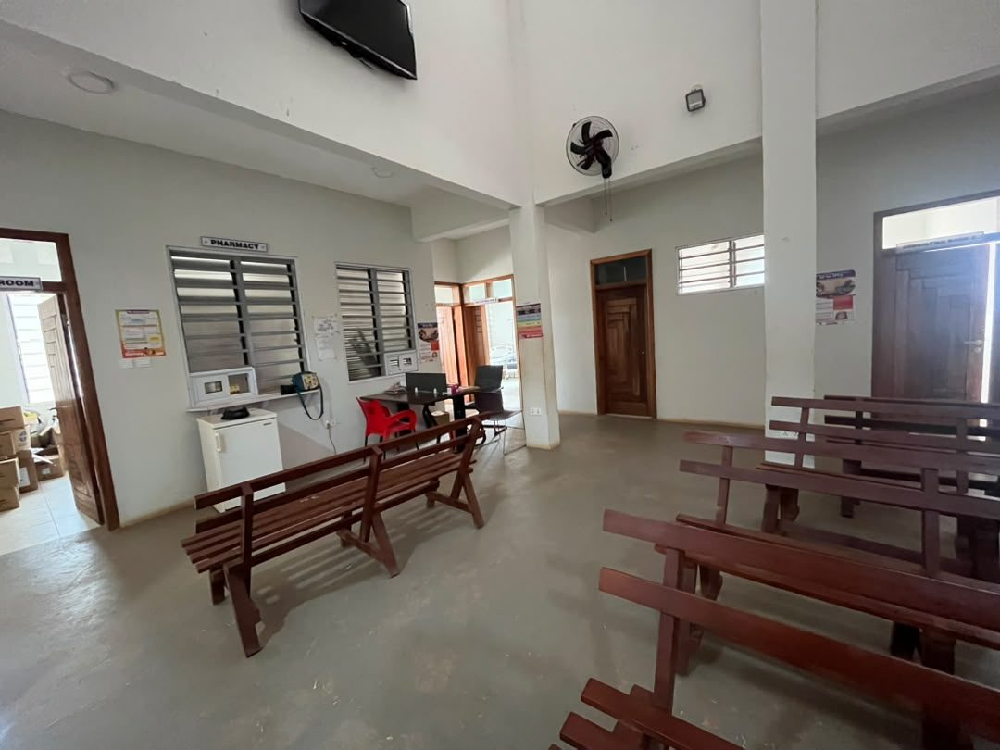
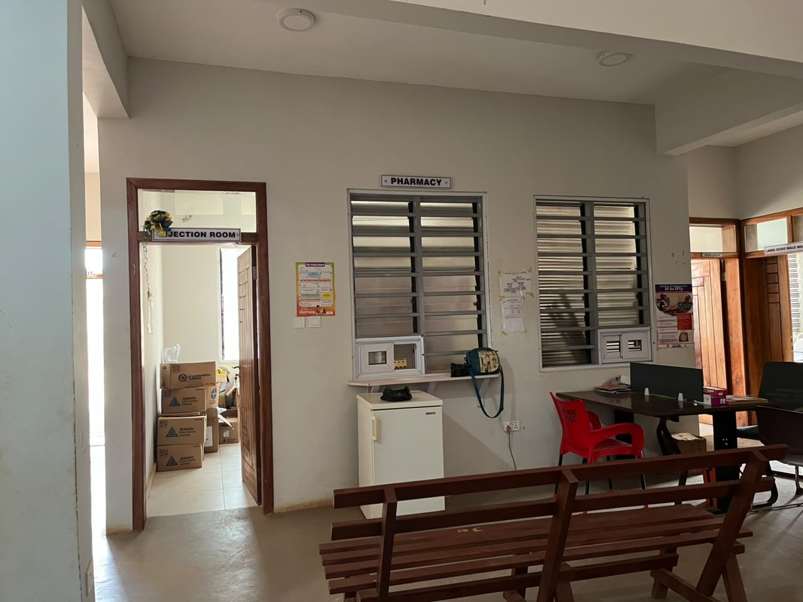
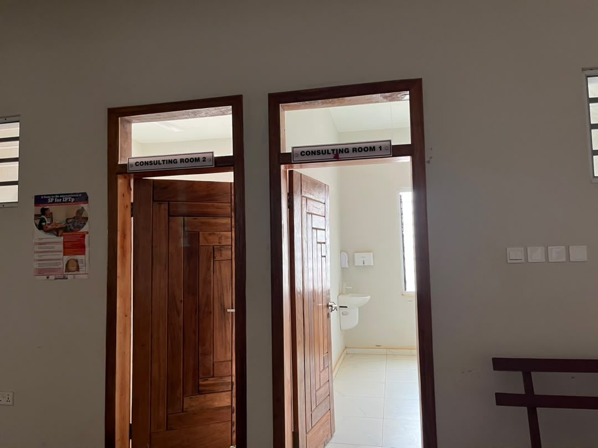
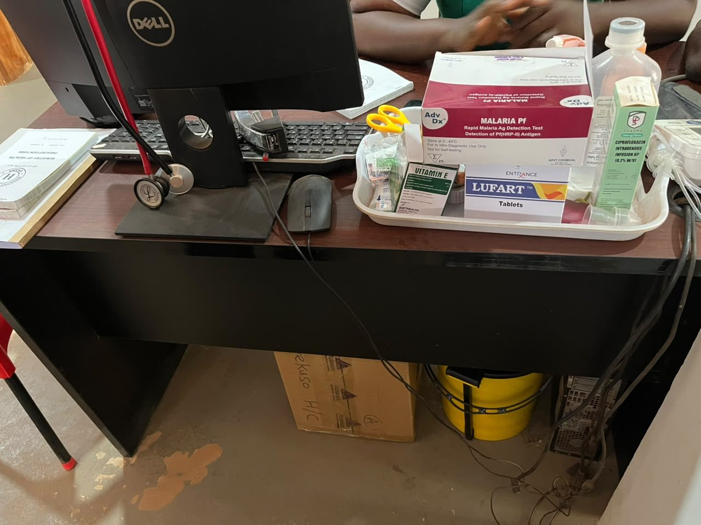

# Photos from the health-centre visit (23 Nov 2026)

These are photos from the visit behind [P01](../interviews/2026-11-23-P01-patient-health-centre.md) and [S01](../interviews/2026-11-23-S01-nurse-health-centre.md). Only photos with no patients or staff in them, and no facility name, are published here. The full set is kept privately in the team Drive.

| Photo | Shows | Supports |
|---|---|---|
|  | Joseph, Liza, Henry and Kobina on the visit | Team collaboration (#15) |
|  | The waiting area, empty mid-morning | F7: low volume, no queue |
|  | The waiting benches next to the pharmacy window | F5: one nurse also dispenses |
|  | Two consulting rooms, one prescriber | F5: staffing |
|  | The nurse's desk: a computer used only for NHIS claims, with supplies beside it | F5: the staff side is paper-based |
